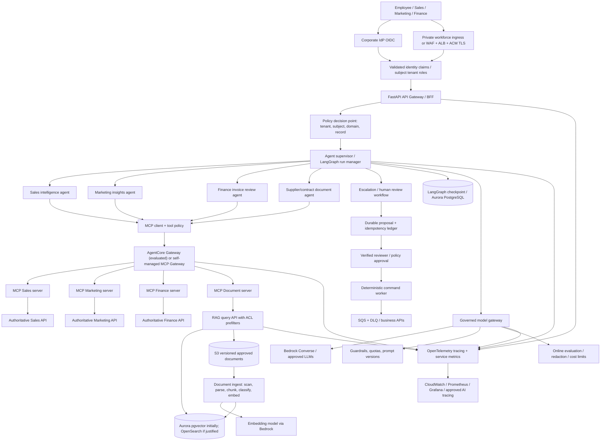

# LSK Enterprise Agentic AI — target runtime architecture (AWS)

**ADR status: Proposed, NOT deployed or production accepted.** This design extends the separate commercial Gateway/Sales/Marketing/Finance synthetic apps. Existing code does not yet expose production MCP servers or an integrated commercial LangGraph runtime; the earlier independent report graph is not equivalent. All production capabilities are gated.

## Full runtime topology

**Trust boundary:** Client -> identity/PDP -> agent state -> individual authorized tools. MCP's discoverable interface does **not** grant authorization by itself. Every target server MUST validate an attributable caller and scope against its own records. Do not let the model forge `X-Actor`, tenant, role, OAuth tokens, or approval decisions. AgentCore Gateway is optional: verify target connectivity, actual OAuth on-behalf-of support and private VPC egress in your chosen region before a design commitment.

## Layer responsibilities

### 1. Application and identity
- Workforce SSO, JWT signature/issuer/audience/expiry checks, server-owned tenant identity, OPA/Cedar-style policy decision point if warranted, anti-CSRF and request-level quotas. Identity must be propagated as verifiable scoped delegation, not as unauthenticated headers.
- Internal EKS Services with network policy and mTLS as needed. API BFF returns typed responses, citations, tool status, model metadata and trace id. Business APIs remain the only source of authoritative CRM/marketing/finance calculations.

### 2. Agentic orchestration (LangGraph)
- Supervisor: classify intent, select domain policy, plan at most a configurable number of steps, retrieve facts, call bounded tools, draft explanation and verify evidence, finish or escalate. Graph entrypoints: `/v1/agents/runs` and `/v1/agents/runs/{id}` **proposed APIs, not currently implemented**.
- Typed state: run_id, subject/tenant/domain, intent, permitted_tool_ids, prompt/model version, evidence IDs, provenance, approvals, budget counters, deadlines, trace ids.
- Aurora/PostgreSQL-backed checkpoint persistence. Resume safely across pod restarts, defend against duplicate tool executions with idempotency keys, terminate by recursion/step/time/token limits, and fail closed on missing policy.
- Specialist agents operate behind deterministic tool allowlists. Use parallel read-only calls only when identity/policy permits; never parallelize order-changing actions before approval.
- High-risk requests become pending human approvals in durable workflow. The reviewer must be a distinct verified principal; the LLM cannot approve.

### 3. MCP and integration (required)
- Use the official MCP Python SDK and declared JSON schemas to implement four domains: `sales-mcp`, `marketing-mcp`, `finance-mcp`, `documents-mcp`. Deploy each as private EKS service (or target via an authenticated AgentCore Gateway).
- **Read-only tools first:** `sales.list_accounts`, `sales.account_insight`, `marketing.campaign_performance`, `finance.invoice_variance`, `documents.search_authorized`. Tool names are target contracts, not proof they exist.
- **Mutations separate:** `proposals.create_pending` with idempotency; `approvals.review` is a distinct employee-facing service, **not** a general agent tool. No `execute_payment` / `write_erp` MCP surface by default.
- Enforce allowlisted tools, parameter schema and size, signed/delegated identity, per-tool downstream authorization, rate limits, circuit breakers, short timeouts, bounded retries, target/network allowlists and structured audit. Treat all MCP server output as untrusted text.
- Test both choices (custom MCP gateway vs managed AgentCore Gateway); compare latency, isolation, supported transports, cost, auth, portability and operational ownership in an ADR. Avoid asserting AgentCore handles delegated end-user record ACLs automatically.

### 4. RAG / knowledge pipeline (required)
- Ingest from S3 versioned documents and approved source connectors: quarantine and malware scanning; PII classification; owner/license/retention metadata; parse (PDF/Textract only where needed); chunk with semantic/overlap design; embed with a versioned Bedrock embeddings model; index tenant/subject/domain ACL fields, document_id, version and checksum.
- Retrieval: authenticate -> filter tenant+record entitlement **before search/result assembly** -> hybrid keyword/vector search, optional rerank, return top-k typed evidence with immutable source identifiers, page/chunk/version and relevance. Filter post-query as defense in depth, never substitute it for index/DB-level tenant controls.
- Manage update/delete reindex, expired records, purge of indexed chunks, replayable ingestion, embedding migrations, incremental sync and drift checks. Guard against prompt injection in retrieved documents. No customer data in synthetic POC.
- Start with Aurora PostgreSQL + pgvector if supported by your chosen engine/version and measured throughput; move to OpenSearch only when relevance/scale/cost justify. Bedrock Knowledge Bases can be a measured alternative, but MUST demonstrate equivalent entitlements and source provenance before adoption.

### 5. LLM and governance
- Implement `model_gateway` over Bedrock Converse with approved model IDs/inference profiles, per-intent model routing (small model for classification; stronger model for grounded reasoning), temperature/prompt/tool schema versioning, model timeouts/retries/budgets, output schemas and explicit no-model response.
- Model candidates (not commitments): Amazon Nova family, Anthropic Claude family, approved Bedrock embeddings. Verify region, model access, data policy, price, context limits and supported API before selecting. Do not hardcode a supposedly latest model ID.
- Bedrock Guardrails and policy classifiers as defense in depth, not substitutes for permissions. Meter tokens/latency/cost by tenant and task; avoid storing sensitive unredacted prompts/traces without approval. No unapproved external LLM fallback.
- Evaluation gates: golden business records/answer sets, faithfulness, citation accuracy, exact tool selection/args, task success, denied access, prompt injection, PII leakage, hallucination, latency p95, cost/request and resilience. Test model, prompt, tool schema, embeddings and index changes separately; block promotions on regression.

### 6. Observability and release
- Trace: request -> agent run -> planning -> each MCP call -> service API -> RAG retrieval -> Bedrock -> response/approval. OpenTelemetry span attributes must not include PII, API keys, session tokens, or full sensitive documents.
- Counters/histograms: agent runs, step count, MCP policy denials and failures, retrieval precision tests, evidence coverage, Bedrock tokens and costs, blocked unsafe outputs, checkpoint error, dead-letter queue depth, pending approvals, p95/p99 latency.
- ECR immutable images, SBOM + signing, GitHub Actions tests, GitOps promotion, environment isolation, release rollback. Instrument independent business availability (not dependent on model).
- Optional MLflow/LangSmith evaluation registry only if lifecycle/evaluation ownership warrants it. This project is inference + RAG; Ray/GPU training is **not** necessary until a real ML training workload is approved.

## Security scenarios to demonstrate
1. Employee A denied Finance record owned by another tenant, even if agent and MCP attempt to request it.
2. Prompt injection in supplier document cannot make agent invoke a write tool or disclose a secret.
3. Revoked user token cannot continue a previously authorized checkpoint without revalidation.
4. MCP timeout/degraded model returns transparent partial failure; deterministic Sales/Finance APIs still available.
5. Duplicate proposal request produces a single durable pending record. Model never executes ERP writes.
6. Retrieved doc deletion removes vector index entries; stale version cannot surface after retention cutover.
7. A forged `X-Role: reviewer` header cannot approve or modify a transaction.
8. Model/embedding version regression fails evaluated deployment gate.

## ADRs to produce while implementing
- 008 Managed AgentCore Gateway vs private self-hosted MCP gateway
- 009 LangGraph checkpoints in managed PostgreSQL and replay/idempotency
- 010 Aurora pgvector vs OpenSearch vs Bedrock Knowledge Bases (ACL and cost benchmark)
- 011 Bedrock model selection/routing and no-fallback vs controlled fallback
- 012 Tool identity delegation; service identity alone insufficient for per-user authority
- 013 Memory retention and PII-safe telemetry
- 014 LangGraph application-controlled approvals vs Step Functions durable external command workflow

## Delivery / stage labels
**Existing:** deterministic four-service synthetic API integration; basic ACL JSON search; direct read-only Bedrock Converse; pending SQLite proposals; separate legacy report graph / tool adapters.
**To implement:** actual MCP servers, secured MCP gateway/identity delegation, commercial LangGraph graph/checkpointing, scalable RAG/vector/ingestion, model governance/eval registry, pilot OIDC, managed DB, workflow approvals and observability.
**Production:** withheld until real identity, tenant record ACL, load/restore/red-team drills, operator ownership and signed business approvals.
