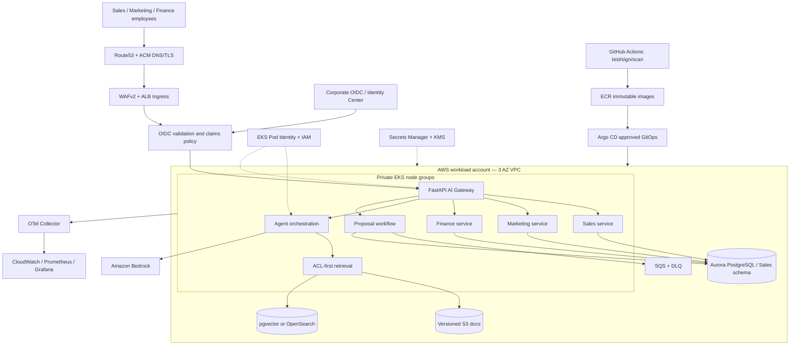

# Target enterprise architecture — LSK Commercial AI Enablement

> **Detailed agentic runtime reference:** [AGENTIC_AI_ARCHITECTURE.md](AGENTIC_AI_ARCHITECTURE.md). This includes the required MCP servers and gateway, LangGraph supervisor/specialist agents, ACL-enforced RAG and document ingestion, Bedrock model gateway, evaluators, memory/checkpoints and approval services. The simplified infrastructure diagram below is NOT the full AI design.

**Kubernetes operations detail:** [EKS, Helm, Argo CD and autoscaling design](kubernetes/README.md); [Task 04A](tasks/04a-kubernetes-operations.md) and [Task 06A](tasks/06a-helm-argocd.md).

**Target design / not yet deployed.** Implement incrementally; the current repository remains a synthetic POC. Do not claim production readiness until proven by application and platform gates.

## Logical network zones

- AWS Organization: security/log archive account, shared services as approved, separate nonprod and production workload accounts. Region example: us-east-1; backup region defined by resilience requirements, not deployed by default.
- VPC across three supported AZs. Public subnets: ALB and per-AZ NAT when justified. Private application subnets: private EKS nodes and internal services. Isolated data subnets: Aurora and caches, no direct internet route. Private endpoint subnets for supported AWS services where this reduces exposure/cost; compare per-endpoint hourly/data charges with NAT.
- EKS control endpoint private or restricted public CIDRs by approved administrator access architecture; scoped SGs, network policies actually enforced by selected CNI, private DNS and TLS between services where required.
- Edge choice: workforce-only applications should prefer private entry (VPN/Direct Connect or verified internal proxy). Public ALB is an explicitly approved alternative with OIDC auth/WAF. Do not expose current synthetic shared-key gateway publicly.
- AWS LB Controller and Argo CD operate with narrowly scoped pod/service identities and pinned chart versions. Terraform owns the AWS infrastructure; GitOps owns app deployments. Avoid both tools managing the same Kubernetes resource.

## Data and reliability
- Managed Aurora PostgreSQL (with separate credentials and ownership) replaces local SQLite only after actual code migrations and versioned DB schema changes. HA and backup/PITR required in pilot/prod; Multi-AZ != cross-region DR.
- Proposal command processing: authenticated submitter -> durable idempotency record -> human review with verified identity -> approved worker -> deterministic business API; default no writes. SQS DLQ and replay controls with auditable transitions. These components do not exist in the current POC.
- Retrieval: classify docs, run controlled ingestion, attach tenant/document/actor ACL metadata, prefilter results, cite versioned sources, evaluate access and prompt injection before invoking Bedrock. Choose pgvector vs OpenSearch based on scale and operations cost.
- Bedrock: explicitly approved model and region, Pod Identity IAM scoping, model/version evaluation, latency/timeouts, budgets, no accidental automatic use of model when unavailable.
- Reliability: PDB, HPA, topology spread across AZs, independent health/readiness, EKS upgrades, monitoring, restores, DR game day, SLOs measured (not just proposed).

## Threat boundaries / ADRs
1. **Real identity is mandatory before pilot:** authenticated corporate user -> validated JWT/claims -> service/record-level authorization. X-Actor and X-API-Key remain synthetic-only.
2. **No agent transaction authority:** Bedrock drafts/explains. Deterministic code processes validated commands after authorized human approval.
3. **No trusted retrieved instructions:** RAG data is untrusted; tool outputs are data; evidence includes source IDs and tenant entitlements.
4. **State separation:** Terraform S3 state bucket is shared foundation with separate keys and restricted access; independent environment roots. Use `use_lockfile=true`. No secrets in Terraform source/output or Git.
5. **Audit and disaster recovery are measurable gates:** test denied access, live backups/restores, operator paging and rollback rather than treating configuration alone as proof.

## End-to-end user request (target)
1. Finance employee authenticates via corporate OIDC and opens the invoice review portal.
2. Gateway validates claims and account/tenant scope; forwards request to Finance API.
3. Finance API retrieves authoritative invoice/PO/receipt facts from its managed store.
4. Agent requests authorized policy evidence from the retrieval service; evidence ACL filtering precedes model prompts.
5. Bedrock generates a read-only, cited explanation. Failure yields an explicit error; deterministic finance insight still works.
6. User requests a proposed correction; a durable idempotent pending command is recorded, without changing ERP state.
7. Verified reviewer independently approves/rejects; command worker performs policy-checked writes if integrated and authorized, with audit record.
8. Traces, usage metrics, alerts and immutable audit trails make every stage observable.

## Enterprise acceptance
See `README.md`, `tasks/` and `docs/RELEASE_GATES.md`. No non-POC traffic until identity, persistent state, access controls, rollback, backups and runbooks have been implemented and tested.
