# LSK Enterprise AI Platform — Senior-to-Junior Engineer Deployment Guide

**Branch:** `feature/aws-enterprise-terraform`  
**Audience:** Junior platform/FDE engineers shadowing a senior engineer  
**Scope:** From CTO mandate and first AWS login through governed POC, pilot, production and operations  
**Truth in labeling:** This is a **deployment and teaching map**, not a declaration that the target enterprise platform has been deployed. Always separate **verified**, **operator-reported**, **proposed**, and **not yet demonstrated**.

> **Senior engineer principle:** We build from the control plane outward. Identity and cost boundaries first; state second; accounts and network third; runtime, data and AI later. Every change has a reason, an acceptance check, a rollback path and a cost decision. Never imply that a passing `terraform plan` means a working product.

## 0. CTO mandate: the business problem

The fictional LSK commercial organization has Sales, Marketing and Finance teams using separate business systems and manually assembling account, campaign and invoice insights. The CTO requests a practical AI enablement platform that can answer grounded questions, connect existing business APIs, draft proposals, and route sensitive changes to a human reviewer—without inventing facts or allowing models to autonomously change business transactions.

**FDE responsibility:** Interview business owners, enumerate real tasks and authoritative source systems, design integration contracts and success criteria, build a synthetic legacy-first POC, instrument and evaluate it, then earn security/business approval before handling real records.

**Success is evidence, not a tool inventory:** e.g., reduced manual handling measured against a baseline; correct tenant authorization; cited answers; zero unauthorized writes; model cost per successful task; p95 latency; repeatable deployment and recovery. These are **measurement goals**, not achieved metrics.

## 1. Two deployment maps

### A. Platform delivery / control-plane map

```mermaid
flowchart TB
  CTO["CTO mandate + business discovery"] --> REQ["User stories, risks, interfaces, acceptance tests"]
  REQ --> REPO["GitHub branch + synthetic POC code"]
  REPO --> SSO["IAM Identity Center: temporary management role"]
  SSO --> COST["AWS Organizations checks + $20 monthly alert budget"]
  COST --> BOOT["Terraform bootstrap: S3 state bucket"]
  BOOT --> VERIFY["Verify TLS policy, encryption, versioning, public access"]
  VERIFY --> STATE["Protected S3 remote state + lockfile + IAM access"]
  STATE --> VEND["Account vending: dedicated development member account"]
  VEND --> GUARD["Account SSO assignments, SCPs, logging, workload budgets"]
  GUARD --> VPC["Terraform VPC: 3 AZ, private app/data subnets"]
  VPC --> EKS["Private EKS + managed nodes, add-ons, Pod Identity"]
  EKS --> DATA["Aurora, S3, SQS/DLQ, Secrets Manager"]
  DATA --> CICD["GitHub Actions -> ECR images -> approved Argo CD GitOps"]
  CICD --> APP["Gateway + Sales / Marketing / Finance services"]
  APP --> AI["LangGraph + MCP + ACL-aware RAG + Bedrock"]
  AI --> EDGE["Verified OIDC + authorized access + TLS ingress"]
  EDGE --> OPS["OpenTelemetry, SLOs, alarms, restore and incident drills"]
  OPS --> GATE["Security tests, business UAT, release approval"]
  GATE --> PILOT["Pilot -> production, only after gates"]
```



**Do not confuse an architecture arrow with evidence that the step has been deployed.** Tasks 03–12 are target stages described in the existing [enterprise README](README.md).

### B. End-user request / runtime map (target architecture)

```mermaid
sequenceDiagram
  actor User as Authorized Sales/Marketing/Finance user
  participant Edge as Private entry or ALB/WAF
  participant Auth as OIDC + tenant/record policy
  participant API as FastAPI Gateway
  participant Agent as LangGraph supervisor
  participant MCP as Scoped MCP gateway/tools
  participant Biz as Authoritative business APIs
  participant RAG as ACL-first RAG
  participant LLM as Bedrock via governed model gateway
  participant Approver as Separate verified human reviewer
  User->>Edge: Ask invoice variance / campaign insight
  Edge->>Auth: Validate session/claims
  Auth-->>Edge: Verified subject, tenant, scopes
  Edge->>API: Authorized request
  API->>Agent: Intent, policy, trace ID
  Agent->>MCP: Allowlisted read-only business tool
  MCP->>Biz: Reauthorize per record; fetch facts
  Biz-->>MCP: Structured authoritative data
  MCP-->>Agent: Evidence with source IDs
  Agent->>RAG: Search permitted policies/contracts
  RAG-->>Agent: Entitled citations, not instructions
  Agent->>LLM: Bounded context + versioned prompt
  LLM-->>Agent: Grounded draft or explicit failure
  Agent-->>API: Cited explanation
  API-->>User: Result + trace reference
  opt User requests a transaction correction
    User->>API: Create proposal
    API->>Approver: Durable pending request; no write
    Approver-->>API: Independent approve/reject
    Note over API,Biz: Only deterministic authorized worker may make a downstream write
  end
```

**Important:** These agent, MCP, RAG and approval flows are **future integration contracts**; current repo documentation describes synthetic POC services and a direct read-only Bedrock path, not an already deployed end-to-end LangGraph/MCP commercial application. See [Agentic AI architecture](AGENTIC_AI_ARCHITECTURE.md).

## 2. Status ledger — evidence versus aspirations

| Milestone | Status as of this walkthrough | Evidence / remaining proof |
|---|---|---|
| AWS organizations management SSO profile `lsk-management` | Verified from CLI output | STS assumed-role identity, AWS Organizations `FeatureSet=ALL` |
| Static AWS credential environment variables | Verified absent in the checked Git Bash session | Shell checks; repeat in any fresh terminal |
| Account vending default | Verified read-only/no AWS changes in plan | `management_account_verified=true` output-only plan; `create_account=false` |
| Management-account AWS Budget | Verified $20 monthly | Actual-spend alerts 50%/$10, 75%/$15, 100%/$20; 75% email subscriber shown |
| Bootstrap Terraform formatting / validation | Verified | Terraform init and validate succeeded |
| Bootstrap S3 Terraform plan | Verified | Six planned creates, zero change/destroy |
| Bootstrap S3 creation | **Operator-reported/strongly indicated** | `terraform output` now lists bucket name/ARN/account/region; request the apply log and AWS API confirmations |
| S3 bucket security properties | Not yet independently verified | Query encryption/versioning/public access/HTTPS policy and inspect output |
| Remote state migration + native lockfile | Not yet demonstrated | `terraform init -migrate-state` where appropriate, correct backend key, lock concurrency test |
| Dedicated `LSK-AI-Development` account | Not created in shown evidence | Approved plan and Organizations creation status |
| VPC, EKS, databases, ingress, GitOps | Design / gated implementation | Terraform plans, successful applies, workload health and security tests |
| Production MCP, LangGraph commercial agents, ACL-first RAG | Design / gated implementation | Runtime integration tests, evaluation and tenant isolation evidence |
| Pilot / production | Not accepted | Signed release gates, security, DR, cost and business acceptance |

### Current known AWS foundation

- Region: `us-east-1`
- S3 bucket output: `lsk-ai-platform-proj1asr`
- Bootstrap working directory: `/c/terraform-work/lsk-ai-poc/bootstrap` (outside the previous OneDrive-synced repository tree)
- Branch: `feature/aws-enterprise-terraform`
- Budget: $20 **monthly alert threshold, not a service shutdown or hard cap**
- Do not record the complete AWS account number, account owner email, SSO authorization code or token in documentation.

## 3. What a senior engineer teaches at every stage

### Stage 0 — Discovery, before choosing services

**Question:** What do users do today, what source of truth exists, and which decisions can an agent safely support?

**Why:** An AI platform cannot fix ambiguous ownership, missing business rules or untrusted data. Model confidence is not transaction authority.

**Work:** Shadow Sales, Marketing and Finance; capture sample request/response and exception scenarios; classify data; record source APIs, rate limits, identities, SLAs, approval authority; define POC/pilot/production acceptance criteria and a small cost envelope.

**Check:** Every proposed tool has an owner, read/write classification, policy and failure mode. POC uses synthetic records only.

### Stage 1 — Repository, branch and workstation

**Why:** Code review, reproducibility and isolated environments prevent tribal-knowledge deployments.

```bash
git clone --branch feature/aws-enterprise-terraform https://github.com/nolet7/lsk-ai-poc.git
cd lsk-ai-poc
git branch --show-current
aws --version
terraform version
helm version
kubectl version --client
```

**Check:** Appropriate Terraform version, intended branch, reproducible provider lockfile. This Git branch is for enterprise AWS work, while `deploy/aws/ec2/` is a separate Compose reference lab.

### Stage 2 — AWS SSO and Organizations boundaries

**Why:** The management account can govern or create other accounts; normal application deployment should **not** rely on management-account administrator credentials. Prefer scoped temporary roles and MFA.

```bash
aws configure sso --profile lsk-management
aws sso login --profile lsk-management
export AWS_PROFILE=lsk-management
aws sts get-caller-identity --query '{Account:Account,Arn:Arn}'
aws organizations describe-organization --query 'Organization.{FeatureSet:FeatureSet,ManagementAccountId:MasterAccountId}'
```

**Check:** Management-account assumed role and expected organization; do not share unredacted identifiers. When a session expires, renew it; never replace it with static IAM keys.

**Failure lesson:** An IAM Identity Center user can exist without a permission-set assignment. A configured permission set is not access until assigned to the correct account. Identical email addresses do not turn an SSO user into the AWS root user.

### Stage 3 — Costs before resources

**Why:** EKS, NAT gateways, load balancers, managed databases and inference accrue costs even when no user is working. AWS Budgets does not enforce a hard ceiling.

**Actual lab control:** $20/month; alert at $10, $15 and $20. Check subscribers for **each** notification. Prefer control-plane-only labs until individual service costs are estimated; avoid leaving always-on EKS/Aurora/NAT under this budget.

```bash
ACCOUNT_ID=$(aws sts get-caller-identity --query Account --output text)
aws budgets describe-budget --account-id "$ACCOUNT_ID" --budget-name LSK-AI-Platform-Monthly-Budget
aws budgets describe-notifications-for-budget --account-id "$ACCOUNT_ID" --budget-name LSK-AI-Platform-Monthly-Budget
```

**Check:** Correct budget amount, intended account scope, correct subscribers and email verification. Aggregate management-account spend is not equivalent to a per-workload-account cap.

### Stage 4 — Terraform bootstrap: why S3 comes first

**Why:** State binds Terraform resource addresses to AWS resources. A lost state file can cause accidental duplicates or unmanaged resources. Git and OneDrive are not state backends. A remote S3 backend, with isolation by state key, adds centralized access control, versioning and concurrent-write protection.

The initial S3 bucket must be created **before it can store Terraform's own state**. Therefore `terraform/bootstrap` intentionally starts with **local state**, from a protected working folder, and is subsequently migrated with a controlled plan. Do not simply copy the state to an arbitrary new path or initialize as empty after resources exist.

```bash
# Git Bash, copied working directory outside OneDrive:
cd /c/terraform-work/lsk-ai-poc/bootstrap
export AWS_PROFILE=lsk-management
terraform fmt -check -recursive
terraform init -backend=false
terraform validate
terraform plan -out=bootstrap.tfplan
terraform show bootstrap.tfplan
# Human-approved only:
terraform apply bootstrap.tfplan
terraform output
```

**Expected reviewed plan:** Six S3 resources: bucket; versioning; AES256 server-side encryption; four public-access blocks; BucketOwnerEnforced; TLS-deny bucket policy. `force_destroy=false` and `prevent_destroy` are deliberate. An output is not a guarantee that bucket controls are operational.

**Next required verification (not yet evidenced):**

```bash
BUCKET=$(terraform output -raw state_bucket_name)
aws s3api head-bucket --bucket "$BUCKET"
aws s3api get-bucket-versioning --bucket "$BUCKET"
aws s3api get-bucket-encryption --bucket "$BUCKET"
aws s3api get-public-access-block --bucket "$BUCKET"
aws s3api get-bucket-ownership-controls --bucket "$BUCKET"
aws s3api get-bucket-policy --bucket "$BUCKET" --query Policy --output text
```

**Review results:** Versioning `Enabled`; `AES256`; all four public-access flags `true`; owner enforced; policy denies requests when `aws:SecureTransport=false`. Do not post sensitive policy/principal details publicly.

### Stage 5 — State migration and lock safety (gated, NOT done)

**Why:** A Terraform process and a CI process must not overwrite state at the same time; state access must be narrower than AWS infrastructure administration.

**Senior review before touching state:**
1. Confirm the existing `terraform.tfstate` safely records the six S3 resources, and keep a restricted, encrypted offline backup; do not commit or paste it.
2. Verify remote bucket controls and specify a dedicated key, e.g., `management/bootstrap/terraform.tfstate`. Reserve distinct `management/account-vending/terraform.tfstate` and per-environment keys.
3. Restrict bucket/object/lock-file IAM actions to approved state principals. Include `.tflock` permissions and review access logs, recovery and version retention.
4. Add an explicit S3 backend configuration to the bootstrap root and use `use_lockfile=true`. **Do not run this until the module is updated and reviewed.**
5. From the same directory containing the authoritative local state, perform `terraform init -migrate-state` interactively, verify state with `terraform state list` and `terraform plan`. Confirm no resource creations after migration. Never `-reconfigure` away an existing state without a state recovery plan.

**Do not use `terraform apply` or `terraform destroy` as a state migration procedure.** S3 server-side encryption and S3 versioning are not substitutes for restricted IAM and backup/restore verification.

### Stage 6 — AWS Organizations account vending (gated, NOT done)

**Why:** Put experimental workloads in a dedicated member account, not the organizations management account. Account separation limits blast radius, billing confusion and administrative overlap.

```bash
cd /path/to/lsk-ai-poc/deploy/aws/enterprise/terraform/account-vending
export AWS_PROFILE=lsk-management
terraform init -backend=false
terraform validate
terraform plan
```

**Safe default:** `create_account=false`; the observed plan reported only `management_account_verified=true`. No AWS account creation should occur.

**Before enabling:** Confirm whether Control Tower governs account creation; choose an approved OU; specify a unique dedicated contact email; secure the account-vending backend state; approve budget, SCPs, central logging and account access workflow; separately authorize creation. Do **not** execute a creation apply merely because SSO and plan validation pass.

After creating the account, assign SSO permission sets to the **new account**. Management-role SSO access does not automatically imply permissions in its child account. Verify AWS Organizations creation status before retrying.

### Stage 7 — Networking, subnets and egress (target, gated)

**Why:** Database and application nodes should not be directly reachable from the internet. Subnets, SGs and routing define trust boundaries.

Target three-AZ VPC: public edge where approved; private app/EKS node subnets; isolated data subnets; VPC endpoints where operationally/cost justified. Choose NAT only after budgeting recurring hourly and data charges. AWS accounts and state keys should be separated by environment.

**Check:** Route tables, SG ingress/egress, private addresses, endpoint DNS, connectivity and denied direct inbound tests. Reference [task 03](tasks/03-network-foundation.md).

### Stage 8 — EKS and cluster platform (target, gated)

**Why:** Container orchestration standardizes deployment but creates an ongoing operational burden. Use it for justified service scale and operational constraints, not simply to claim Kubernetes experience.

Target private managed nodes, EKS add-ons, scoped RBAC, managed node groups with conditional Karpenter, Pod Identity, PDB, topology spread, readiness/liveness, autoscaling and EKS upgrades. The current sample Helm chart is **POC-only**, not production HA.

**Check:** Nodes Ready, pod authorization negative tests, pod placement, controller IAM, capacity and rolling upgrades. See [Kubernetes operations track](kubernetes/README.md).

### Stage 9 — Managed data and service boundaries (target, gated)

**Why:** Business facts must remain authoritative; agent outputs are explanations, not database truth. Durable writes must survive restarts and enforce idempotency.

Replace synthetic SQLite for approved pilots with managed PostgreSQL/Aurora and isolated databases/users; document/object provenance in S3; SQS/DLQ for approved commands. Measure point-in-time restore, segregation, retention and cost. Separate Sales/Marketing/Finance schemas and service identities.

**Check:** Tenant isolation, schema migrations, least-privilege service roles, backup restore, duplicate message replay without duplicate downstream writes.

### Stage 10 — CI/CD, application delivery and identity (target, gated)

**Why:** The exact image tested should be the image released; the team needs reviewable promotion and a fast rollback.

Use GitHub Actions tests/scanning/SBOM/signing, ECR immutable image digests, Argo CD approval-based GitOps, separate Helm values, Secrets Manager and Pod Identity. Terraform owns AWS infrastructure; Argo CD owns approved Kubernetes application resources. Do not let two reconcilers own the same resource.

**Check:** Commit-to-digest traceability, signed provenance, blocked failed tests, deployment health, rollback test. Before pilot, replace synthetic shared API keys and `X-Actor` with real OIDC JWT validation and record-level policy enforcement.

### Stage 11 — Agentic AI / MCP / RAG / LLM integration (target, gated)

**Why:** A language model is not a trusted policy decision point. LangGraph coordinates work; MCP exposes **constrained** capabilities; RAG supplies evidence with enforceable ACLs; deterministic domain APIs supply facts. The model cannot sign off on its own writes.

- **09A MCP:** private Sales, Marketing, Finance and Document tool services; per-user delegated authorization, allowlists, validation, audit, no unrestricted `write_erp` tool.
- **09B LangGraph:** bounded supervisor and specialists; typed state, durable checkpoints, retries/idempotency and termination limits.
- **09C RAG:** approved document ingestion, classified chunks, tenant/record entitlement *before* retrieval, citation/version/refresh/delete checks; pgvector first if validated, OpenSearch only with measured justification.
- **09D LLM governance:** Bedrock via model gateway, approved region/model, prompt versions, schema/guardrails, token-cost caps, evaluation and fail-closed behavior.
- **09 integration:** real end-to-end request with deterministic APIs, policy denials, citations, approved human escalation and traced execution.

**Check:** Unauthorized tenant cannot retrieve documents or call tools; prompt injection in an external document does not grant new authority; duplicate proposal stays one record; model outage returns explicit fallback; revoked identity invalidates resumed agent work. See [agentic architecture](AGENTIC_AI_ARCHITECTURE.md).

### Stage 12 — Production entry, reliability and governance (target, gated)

**Why:** Correctness in a one-user lab does not establish production reliability. Exposure, identity, load, rollback and cost are release decisions.

Decide private workforce ingress vs an approved ALB + ACM TLS + WAF. Instrument OpenTelemetry traces, business metrics, SLI/SLO, alerts and on-call runbooks; test scale, IAM revocation, AZ failure, RAG leakage, model outages, restore and response time. Perform pilot UAT and explicit sign-off before production.

**Check:** Security and business sign-off, measured SLOs, evaluated cost, restore exercises, operator ownership and release gates. Consult [release acceptance](docs/RELEASE_GATES.md). Do not claim the aspirational 99.9% objective as achieved.

## 4. Why the order matters — five engineering rules

1. **Identity before Terraform:** Without verifying the caller, a correct plan can apply in the wrong account.
2. **Budget before expensive infrastructure:** Alerts cannot undo an unexpected EKS/NAT/Aurora bill.
3. **State before account creation:** Organization resources must have a stable protected state record before provisioning.
4. **Business APIs before agents:** LLMs need authoritative facts and deterministic rules to avoid invented financial/commercial answers.
5. **Authorization before pilot:** A prototype that accepts `X-Actor` or shared keys is not a production trust boundary.

## 5. Troubleshooting lessons from the actual lab

| Symptom | Cause / lesson | Correct response |
|---|---|---|
| `No AWS accounts available` during SSO CLI setup | Identity Center permission set was not assigned to a user in target account | Assign enabled user + role to **correct account**, verify provisioning, rerun CLI |
| Permission set showed `Not provisioned` | Creating a permission set does not assign it | Finish multi-account assignment |
| SSO offered delegated-admin and management accounts | Two assignments now exist; first highlighted entry need not be correct | Explicitly select management account for Organizations control plane; remove unnecessary privilege after review |
| `terraform plan` asks for `owner_tag` | Required Terraform variable lacks a default | Set approved nonsecret value in local protected tfvars |
| `DuplicateRecordException` in Budgets | Existing 50% notification | Update existing notification; do not blindly recreate |
| Terraform plan shows six S3 resources | Expected bootstrap state bucket creation | Inspect actions, save plan, human-approve, apply |
| `terraform output` lists S3 bucket | Terraform state has recorded output values | Independently query AWS for S3 security properties; confirm apply log |

## 6. Safe release checklist and cost stop points

| Gate | Approver / evidence | Stop if |
|---|---|---|
| Identity | Platform owner: correct account/role, MFA | Wrong account, static/root keys |
| State | Platform/security: protected S3, keys, IAM, recovery | Local sync copy is sole state or migration unverified |
| Cost | Lab owner: service estimates and alert subscribers | Forecast exceeds $20 without explicit revised budget |
| Account | Organization administrator: OU, email, policies | Account factory conflict, unapproved contact email |
| Network | Infrastructure reviewer: private subnets and routes | Public data plane or uncontrolled NAT cost |
| EKS/data | Platform owner: cluster and backup evidence | No tested restore or continuous-cost approval |
| AI | Security/business owner: ACL, eval, transaction policy | Untrusted text can write or cross tenant |
| Pilot/prod | Business and operations owners: UAT, SLO, rollback | No independent approval and failure drills |

## 7. A senior engineer's five-minute explanation to a junior

> We did not start by deploying Kubernetes because that would create infrastructure cost before we had an identity and recovery boundary. We first built a reproducible repository, used AWS IAM Identity Center to assume an authorized management-account role, and proved it using STS and Organizations read-only calls. Then we set a $20 monthly budget with $10, $15 and $20 notifications. We validated the account-vending Terraform root with account creation disabled. Next, we moved our bootstrap working directory outside OneDrive, reviewed a six-resource Terraform plan, and obtained outputs identifying the intended S3 state bucket. The next gate is independent verification of the bucket controls, followed by protected remote state with native S3 locking and separate state keys. Only then do we authorize a dedicated development account, build private network and compute, and roll out deterministic business services before adding LangGraph, MCP, RAG and Bedrock. We do not let an LLM invent data or directly commit a financial transaction. Each stage is tested and costed before promotion.

**If asked “Is it production-ready?”** Answer: *No. The AWS foundation has progressed, but workload platform, delegated identity, managed persistence, end-to-end agent integration, negative security tests, SLO evidence and production approvals remain gated.*

## 8. Source of truth and follow-on reading

- [Enterprise root README](README.md) — roadmap and acceptance gates
- [AWS target architecture](ARCHITECTURE.md) — platform boundaries
- [Detailed agentic AI design](AGENTIC_AI_ARCHITECTURE.md) — LangGraph/MCP/RAG/Bedrock contracts
- [Task 01 prerequisites](tasks/01-prerequisites.md) — first checks
- [Task 02 remote state](tasks/02-terraform-remote-state.md) — bootstrap
- [Account vending root](terraform/account-vending/README.md) — protected control-plane account creation
- [Kubernetes operations](kubernetes/README.md) — EKS day-two responsibilities
- [Release gates](docs/RELEASE_GATES.md) — conditions for pilot/production

**Documentation maintenance rule:** After each accepted task, update the status ledger with the exact command/test evidence, date, environment and reviewer decision. Never replace “designed” with “deployed” merely because a configuration file was committed.
