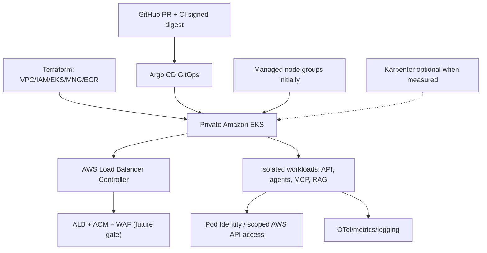

# Kubernetes operations platform — Amazon EKS

**Status:** Target design and reusable starting chart; not deployed. The existing gateway runs only in `LSK_STAGE=poc` and shared-key credentials; pilot/production application deployment is **blocked** until OIDC, tenant ACL, persistence and review gates pass.

## Ownership matrix
| Component | Tool that owns it | Prerequisites |
|---|---|---|
| VPC, EKS cluster, managed node group, Pod Identity associations, cluster IAM, AWS add-on configuration | Terraform | Approved nonprod account, remote state and network foundations |
| Namespace policies, Helm installation of platform add-ons, app Deployments/Services/HPA | Argo CD via Git/Helm | Existing EKS cluster, workload identity, GitOps bootstrap, admission policies |
| Application image build, test, SBOM, sign, ECR publish | GitHub Actions | Pinned source versions, integration test credentials |
| Workload pod scheduling/autoscaling | EKS managed node groups initially; Karpenter later after measured need | EKS capacity strategy, taints/limits, interruption policy |

## System design review and executable tests

- [Operational design findings and ADRs](OPERATIONS_GAPS.md) — specific defects, fixes, and unclosed production risks.
- [Chart negative/render test](tests/check-gateway-chart.sh) — requires Helm v3, Bash and Python 3; run `bash deploy/aws/enterprise/kubernetes/tests/check-gateway-chart.sh` before any cluster apply.
- The sample gateway is deliberately **single replica** due to local SQLite proposal state, and demo writes are disabled. It cannot meet HA SLOs until migrated to a managed durable command store.
- The ingress NetworkPolicy only permits in-namespace pods labeled `lsk.ai/gateway-client=true`. Namespace label governance and actual CNI enforcement must be verified; a compromised pod or unchecked label can undermine this policy.
- A pre-existing Kubernetes Secret is mandatory; Secret rotation requires an explicit application rollout/reload.

## Platform stack
- EKS across 3 AZs with private managed node groups, EKS Pod Identity Agent, VPC CNI networking policy support verified, CoreDNS, kube-proxy if required by selected EKS version.
- AWS Load Balancer Controller, External Secrets Operator (with Pod Identity), metrics-server, cert management according to selected TLS design, OpenTelemetry Collector, Prometheus/Grafana.
- Argo CD on private access path, GitHub Actions CI producing immutable ECR digests. Terraform creates infrastructure, then GitOps owns application charts. Protect against Terraform/Argo overlapping resource ownership.
- Gateway and services: Sales, Marketing, Finance, LangGraph orchestration, MCP gateway and servers, ACL RAG, model gateway, approval workers, OTEL exporters. Each has service identity, quotas, health checks, PDB, NetworkPolicy, limits and telemetry as appropriate.
- Managed node groups **first**: simplest to learn and audit. Add Karpenter in a later task only if measured provisioning efficiency, spot workloads, GPU use, or heterogeneity justify it. Karpenter requires NodePool/EC2NodeClass, interruption handling, pricing and disruption budgets; don't install both autoscalers against the same capacity class without a documented decision.
- Separate `poc`, `pilot`, `production` clusters or accounts in target design; no production namespace with POC auth.

## Runtime

## Deployment artifacts
- [Gateway chart](helm/charts/lsk-gateway/Chart.yaml): a safe learning skeleton, default POC-only; requires private ECR image digest and precreated Kubernetes Secrets. No hardcoded real identity or static credentials.
- [Argo CD Application example](gitops/examples/lsk-gateway-application.yaml): manual sync and placeholder repository/cluster settings; **never apply unchanged**.
- [Task 04 requirements](tasks/04-eks-platform.md) and [Kubernetes platform lab](tasks/04a-kubernetes-operations.md): detailed staged implementation and validation.
- [CI/CD task](tasks/06-build-ecr-ci.md) and [GitOps lab](tasks/06a-helm-argocd.md).

## Required acceptance
1. EKS private compute and correctly configured workload identity/least privilege, image scanning/signing and network policy enforcement.
2. `kubectl get nodes -o wide` displays Ready nodes across approved AZs; no public worker addresses; namespace quotas and pod resource requests.
3. `helm lint`, `helm template`, admission validation and policy checks; image is an immutable digest.
4. Argo CD detects and remediates drift only after review; release via approved PR, then rollback drill.
5. Controlled rolling update with readiness, PDB, startup/liveness checks; HPA/scaling evidence, logs/traces, node replacement drill.
6. Negative tests: untrusted namespace cannot read Secrets, cross-service network deny and unauthorized AWS API denied.
7. Cost and scale review before enabling Karpenter; compare with EKS managed node groups.

**Do not deploy an ALB for the current shared-key gateway.** Use private internal access until application OIDC gates pass.
