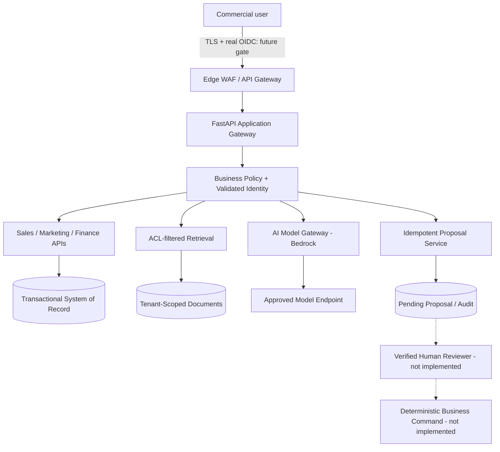

# LSK Enterprise AI Platform — architecture review v2 implementation

**Status:** Implemented commercial AI POC foundation on `main`; the attached six-architecture review is a *reference design*, not proof that all six workloads were built or deployed. All records here are synthetic.

## Executive architecture decision
Keep the six candidate workloads as **separate applications on shared platform capabilities**, not six connected-to-production simulations inside a single repo.

| Reference workload | Ownership / implementation here | Exit requirement |
|---|---|---|
| FDE #1 Customer Operations Agent | **Implemented POC boundary**: API gateway, deterministic Sales/Marketing/Finance APIs, Bedrock read-only model gateway, ACL retrieval, idempotent proposal ledger. No ERP writes. | Tenant isolation, real identity, authorized commands, approval recovery, ERP outage exercises |
| FDE #2 Document Intelligence | **Partial**: ACL-filtered synthetic texts. No OCR, uploads, quarantine, extraction confidence or deletion lifecycle. | Quarantine, PII/AV checks, field accuracy tests, deletion reconciliation |
| AI Platform #3 Developer Platform | **Design only**: separate control/data/model planes. No Backstage catalog or self-service provisioning controller. | Approved template can deploy/observe/decommission without cluster-admin rights |
| AI Platform #4 Fine-Tuning/MLOps | **Design only**: do not train models using runtime customer prompts. No Ray/MLflow training pipeline implemented. | Versioned data/weights/evals, candidate registry, approvals and rollback |
| SRE #5 Incident Investigation | **Design only**: conventional detection/paging must operate without AI. Existing gateway error metrics are not an incident platform. | On-call drill with verified evidence and manual paging during LLM outage |
| SRE #6 Predictive Reliability | **Design only**: time-series predictor and policy controller require independent evaluation. | Compare to baseline, false-action rates and rollback of risky actions |

## Deployment zones and trust boundaries

**Current enforcement:** This repository's `main` implementation uses a shared POC key and a single server-defined synthetic tenant. It rejects all non-POC stages. This is **not** workforce SSO, real multi-tenant isolation, ABAC or document ingestion at scale. Backend transactional writes are not authorized through its model-facing endpoint.

## Boundary assignments
1. **External/API gateway:** rate limits, TLS, OIDC and routing belong at the edge; demo FastAPI only has a shared key.
2. **AI model gateway:** `integrations/bedrock_gateway.py` owns inference limits, provider credentials via AWS role, timeouts and response classification.
3. **Retrieval service:** `integrations/acl_retrieval.py` filters explicit subject/tenant/domain ACL *before* assembling model context.
4. **Business services:** independent applications own deterministic account/campaign/invoice calculations and transaction validation.
5. **Command boundary:** `integrations/command_store.py` provides durable, idempotent **pending proposals only**. It has no ERP adapter, payment API or approval executor.
6. **Control plane:** CI, IaC, GitOps, policy, budgets and model promotion remain isolated from request-time agent authority.

## Key ADRs
- **ADR-001:** Agents may read facts, draft explanations and propose—but not approve or execute commercial transactions.
- **ADR-002:** No LLM fallback may be disguised as a model-generated answer. A missing `BEDROCK_MODEL_ID` returns 503; `use_model=false` explicitly returns `retrieval-only`.
- **ADR-003:** No client-provided tenant is trusted. `LSK_TENANT_ID` is server-defined in the synthetic POC; production must obtain verified tenant claims and enforce backend row/document entitlements.
- **ADR-004:** The canonical business ledger lives outside the AI service. No LLM arithmetic overrides deterministic service metrics.
- **ADR-005:** Transactional changes require durable command validation, idempotency, audit and independent human approval. Until reviewer OIDC exists, no approval path is available.
- **ADR-006:** Model versions, prompt versions, test datasets and retrieval indexes must be recorded for releases; no automatic production prompt-to-training feedback.
- **ADR-007:** Prometheus alerts and incident paging must not depend on Bedrock availability.

## Future infrastructure target (not implemented here)
Multi-AZ private EKS/GKE/AKS workloads; separate workload identities; TLS ingress; namespace RBAC and NetworkPolicies; Terraform remote state and reusable modules; Argo CD signed-image GitOps; managed PostgreSQL/pgvector and queue-backed Temporal workflow; Redis only where measured; object-store versioning; backup/restore exercises; OpenTelemetry and SIEM; per-service token/cost budgets, data retention and DLP. Avoid starting GPU serving/MLflow/Ray until a real model workload requires them.

## FDE end-to-end example
1. Employee asks for synthetic invoice `inv-1002` and relevant review rules.
2. Gateway checks shared POC key and derives the server's synthetic tenant; non-POC environments are blocked.
3. ACL retriever filters subject, domain, classification and tenant **before** any text reaches Bedrock.
4. Finance API supplies deterministic invoice–PO–receipt variance from its own system of record.
5. AI gateway sends only approved synthetic evidence to the configured Bedrock model; no tools are exposed to mutate records.
6. Response includes evidence document IDs and clearly labeled `mode=bedrock-converse`, or a transparent retrieval-only response if explicitly requested.
7. A separate synthetic proposal can be submitted with an idempotency key, but cannot be approved or applied by the model.
8. Outages fail closed; a deterministic `/v1/apps/finance/records/.../insight` route remains independent of Bedrock.

See [release gates](RELEASE_GATES.md) and [Kubernetes blueprint](../deploy/k8s/README.md).
